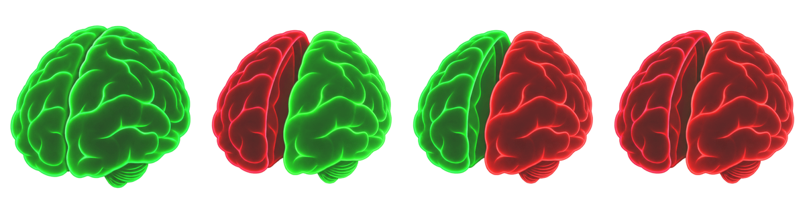

<p align="center">
  
</p>

<h1 align="center">Callosotomy</h1>

<p align="center"><b>Sever the connection before it spreads.</b><br>
A free, open-source privacy and network kill switch for everyday Windows users.</p>

<p align="center">
  
</p>

---

## Why this exists

Cyber attacks are hitting ordinary people more than ever: ransomware, scam pop-ups, malicious downloads, people snooping on public Wi-Fi, and apps quietly sending your data who-knows-where. Most protection tools are built for companies with security teams. **Callosotomy is built for everyone else.**

It gives you one simple, beautiful control over who your PC can talk to:

- **Going somewhere sketchy?** Cut the local network so nobody else on the café, hotel or airport Wi-Fi can reach your computer.
- **Working on something private?** Cut the internet so nothing on your PC can phone home, upload or track you, while your printer and other home devices keep working.
- **Clicked something you shouldn't have?** Cut everything in one press, before anything can spread or send your files away.
- **Not using the internet right now?** Leave it off. A PC that isn't connected can't be attacked over the network.

It's named after the **corpus callosotomy**, a brain surgery that cuts the bridge between the two hemispheres so a seizure can't spread from one side to the other. The tray icon is a brain: **green and whole** when you're connected, and it **splits and glows red** on the side you've cut.

## Your privacy

Callosotomy is a privacy tool, so it holds itself to the same standard:

- **No accounts, no telemetry, no tracking, no ads.** It never collects or sends anything about you.
- **No internet connection of its own.** The one exception is an optional check that only runs *while* you've cut the internet: it tries to open a connection to `1.1.1.1` (sending no data) to prove the block is really holding. You can turn this off.
- **Fully open source** (GPL-3.0), so anyone can check exactly what it does.

## Features

- **Three switches**, shown on the brain:
  - **Internet** (left hemisphere): blocks everything outside your home or office network, including DNS, which closes a common way malware sneaks data out. Your printer, TV and other local devices still work.
  - **Local network** (right hemisphere): blocks other devices on the same network, which stops infections spreading and strangers on public Wi-Fi reaching you. The internet still works.
  - **Everything** (both): full isolation.
- **Hard to undo by accident or by malware.** A protected Windows service enforces the block. Closing the app, signing out or restarting doesn't lift it.
- **Ends open connections**, not just new ones, so anything already talking to the outside world is cut off.
- **Watches itself.** Every few seconds it checks the block is still in place. If anything weakens it, the block is restored and the brain turns **amber** to warn you.
- **Clean, modern design.** A frosted-glass panel opens from the tray icon, and there's an optional floating brain button: click the **left half** for internet, the **right half** for local network, or **press and hold** to cut everything.
- **Network monitor with per-app firewall rules.** See every app that's using the network and what it's talking to, by name (`youtube.com`, not just an IP address), including Windows services hidden inside `svchost.exe`. It watches Windows' own network event stream, so it also catches UDP traffic (QUIC/HTTP3, DNS, games, calls) and connections that last a fraction of a second, with how much data each one used. Flip an app's switch to block it, or add precise rules: allow Spotify only to `*.spotify.com` on port 443, block an app from the internet but not your printer, block a single tracker. The most specific rule wins, and one click turns any live connection into a rule.
- **One-key panic button:** <kbd>Ctrl</kbd>+<kbd>Alt</kbd>+<kbd>K</kbd> cuts everything from anywhere.

## Install

1. Download `Callosotomy-0.3.4-x64.msi` from [Releases](../../releases).
2. Double-click it and follow the installer.
3. Click the brain in the system tray, next to the clock. If you don't see it, click the **^** arrow and drag the brain onto the taskbar.

Works on Windows 10 (1809 or later) and Windows 11. The frosted-glass panel needs Windows 11 22H2 or later; older versions get a solid dark panel.

To uninstall, go to **Settings → Apps → Installed apps → Callosotomy → Uninstall**. Any active block is lifted first, so you're never left offline.

## Use

| To do this | Do this |
|---|---|
| Open the panel | Click the brain in the system tray |
| Cut the internet only | Panel → **Internet**, or click the **left** half of the floating brain |
| Cut the local network only | Panel → **Local network**, or click the **right** half of the floating brain |
| Cut everything right now | <kbd>Ctrl</kbd>+<kbd>Alt</kbd>+<kbd>K</kbd>, or **press and hold** the floating brain |
| Reconnect | Panel → **Restore all connections**, or press and hold the floating brain again |
| Show the floating brain | Panel → **Floating button** |
| See what's talking to the internet | Panel → **Network monitor** |
| Block an app | Network monitor → flip the app's switch to red |
| Block one site or port for an app | Network monitor → **Block site** or **Block port** on a live connection |
| Let an app reach only one place | Network monitor → **Allow only this** on a live connection |

### How app rules work

Each app has a **default** (its switch: green = allowed, red = blocked) plus any number of **rules**. A rule says *allow* or *block*, for a direction, a protocol, ports, and a destination (anywhere, the internet, your local network, a domain like `*.spotify.com`, or addresses). When rules overlap, **the most specific one wins**: an address beats a domain, a domain beats "internet", and a rule with a port beats one without. On a tie, block wins.

App rules can only ever **take access away**. They can't open anything Windows Firewall blocks, and the brain kill switch always wins over them.

**What the colours mean:**
- **Green:** connected.
- **Red:** that side is cut.
- **Amber:** something tried to get around the block; unplug your network cable to be safe.
- **Grey:** the protection service isn't running.

## For IT and businesses

Callosotomy also scales up: an MSI for silent deployment (`msiexec /i Callosotomy-0.3.4-x64.msi /qn`), Group Policy templates, Windows Event Log integration and a command line.

<details>
<summary>Command line, Group Policy and event IDs</summary>

### Command line

```powershell
Callosotomy.exe --status
Callosotomy.exe --sever internet   # or: local, all
Callosotomy.exe --restore
```

Exit codes: `0` ok, `1` usage, `2` denied or bypassed, `3` service unreachable.

### Group Policy

Copy `policy\Callosotomy.admx` and `policy\en-US\Callosotomy.adml` into your PolicyDefinitions folder. The settings appear under **Computer Configuration → Administrative Templates → Callosotomy**.

| Policy | Default | Notes |
|---|---|---|
| Allow standard users to sever connections | On | |
| Allow standard users to restore connections | On | Turn off on managed fleets, so malware running as the user can't lift a block |
| Allow Internet / Local / Everything mode | On | |
| Repair tampering automatically | On | |
| Drop established connections | On | |
| Bypass detection probe | On, `1.1.1.1:443` | Must be an IP address and port |
| Floating panic button | User's choice | Force on or off |
| Allow standard users to create app rules | On | Loosening a rule also needs "restore connections" |

### Event log

Source **Callosotomy** in the **Application** log:

| ID | Level | Meaning |
|---|---|---|
| 1000 | Info | Service started |
| 1100 | Warning | Mode changed (includes who changed it) |
| 1101 | Info | Established connections dropped |
| 1102 | Info | Network changed; local-network rules recalculated |
| 1110 | Warning | App rules changed (includes who changed them) |
| 1111 | Info | Connections dropped after an app was blocked |
| 1120, 1121 | Info | Network monitor event stream started or stopped |
| 1122 | Warning | Event stream unavailable; monitor falls back to the connection table |
| 1200 | Error | Tampering detected |
| 1201 | Warning | Tampering repaired, or a saved block re-applied |
| 1300, 1301 | Critical | **Block bypassed: disconnect the machine physically** |
| 1400 | Warning | Request denied |
| 1401 | Critical | Control channel hijack attempt |
| 1402, 1403 | Warning, Error | Control client dropped, or could not be identified |

</details>

## Honest limits

No software can promise to stop an attacker who already has full administrator control of your PC: they can switch off any program, including this one. Callosotomy makes that much harder and **tells you loudly** when it happens. The one kill switch nothing can bypass is unplugging the network cable or turning off Wi-Fi at the router. The full details are in [docs/THREAT_MODEL.md](docs/THREAT_MODEL.md).

## Build from source

Use Windows with the .NET 10 SDK:

```powershell
.\build.ps1          # tests, self-contained publish, MSI in .\artifacts
```

```
src/Callosotomy.Core      Pure logic: modes, IP-range maths, firewall rule plans, app-rule engine, control protocol
src/Callosotomy.Service   Protected Windows service: firewall enforcement, tamper checks, secured control channel
src/Callosotomy.Tray      Tray app: frosted panel, network monitor, floating brain button, hotkey, command line
installer/                WiX MSI
policy/                   Group Policy templates
assets/art/               Full-resolution brain artwork
```

The only dependencies are .NET and two Microsoft packages: the Windows service host and `TraceEvent` (for reading Windows' network event stream). There are no third-party libraries.

## Security

Found a vulnerability? Please report it privately; see [SECURITY.md](SECURITY.md).

## License

Code and artwork are licensed under [GPL-3.0](LICENSE) © lobotomy-express. You're free to use it anywhere. If you distribute a modified version, you must share its source under the same licence.
